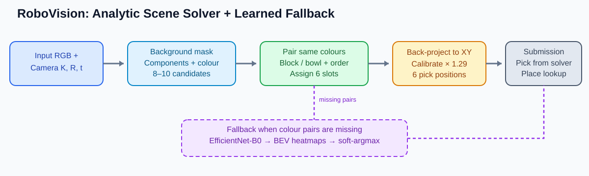

# RoboVision Challenge — Structure-Aware Hybrid Scene Solver

[](https://www.kaggle.com/competitions/robo-vision-challenge-data-hack-3-0)
[](https://github.com/shawnke2025-NUS/RoboVision-Challenge-Solution/blob/main/_posts/2026-11-05-robovision-hybrid-solver.md)

> 中文 Kaggle 技术复盘：场景解析、颜色配对、相机几何与 EfficientNet-B0 learned fallback。上传项目历史记录最高 Public LB 为 **0.87702**（当时记录 1/4，非实时排行榜）。



## 项目入口

- 📖 **[完整中文技术博客](./_posts/2026-11-05-robovision-hybrid-solver.md)**：场景规则、几何标定、网络兜底与结果分析
- 🚀 **[Kaggle 开箱复现说明](./KAGGLE_REPRODUCE.md)**：数据挂载、GPU 设置、Notebook 与提交流程
- 🧪 **[Kaggle Notebook 原页面](https://www.kaggle.com/code/shawnjuyangke/robovision-3-0-deterministic-solver)**
- 🏆 **[Kaggle Competition](https://www.kaggle.com/competitions/robo-vision-challenge-data-hack-3-0)**

| 方案 | 工程记录 Public LB |
|---|---:|
| CNN baseline | 0.44662 |
| 规则解析器 v1 | 0.86025 |
| 规则 + CNN 兜底（另一历史版本） | 0.87254 |
| **改进规则解析器** | **0.87702** |

这些版本来自不同历史实验，不能把结果直接理解为严格控制变量的消融。

## 算法

```text
RGB + camera calibration
     │
Background segmentation → connected components → colour separation
     │
Same-colour pairing → block/bowl classification → slot assignment
     │
Back-project base point → calibration → six pick coordinates
     │
Place coordinates: task type + step lookup
     │
If parsing incomplete: BEV → EfficientNet-B0 → heatmaps → soft-argmax
     │
submission.csv
```

**主要结论：**结构先验比盲目扩大端到端回归网络更重要。先解决物体身份和动作顺序，再估计米制坐标；网络用于处理规则不完整的长尾场景。

## GitHub Pages

本仓库已上传 Jekyll 配置文件。访问仓库 **Settings → Pages**，选择 **Deploy from a branch → main → /(root)** 保存，待构建成功后访问：

https://shawnke2025-nus.github.io/RoboVision-Challenge-Solution/

**当前发布范围**：技术博客、可渲染的算法 SVG 图、Kaggle 复现文档。完整的原始 Notebook、辅助源码及实验附件仍保存在原始工程压缩包 / Kaggle 页面，尚未全部上传至本仓库。本文成绩来自工程记录，未在本次操作中重新训练或提交。
